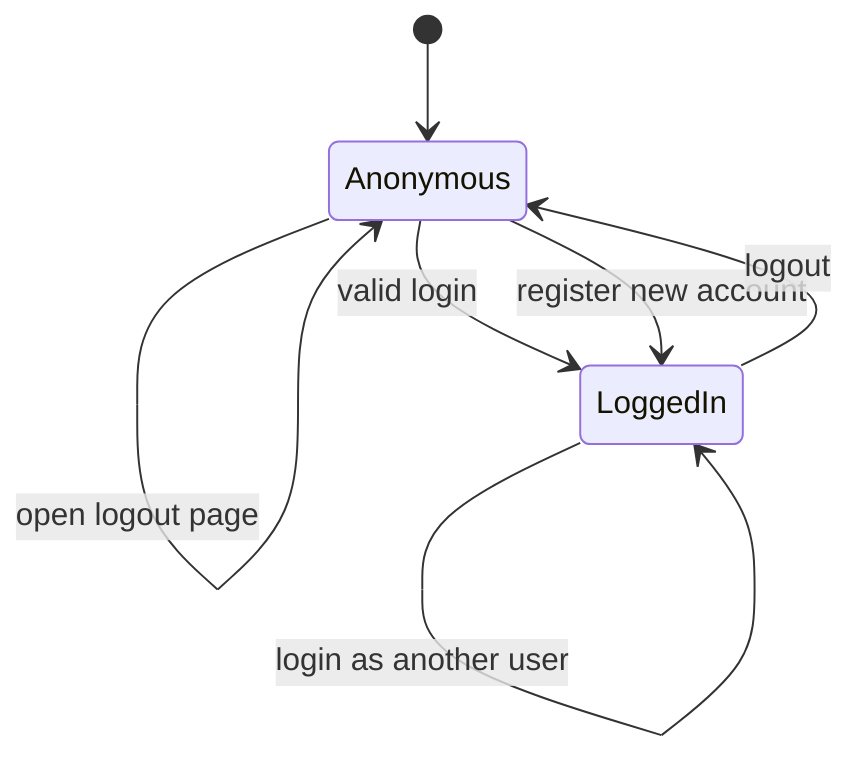
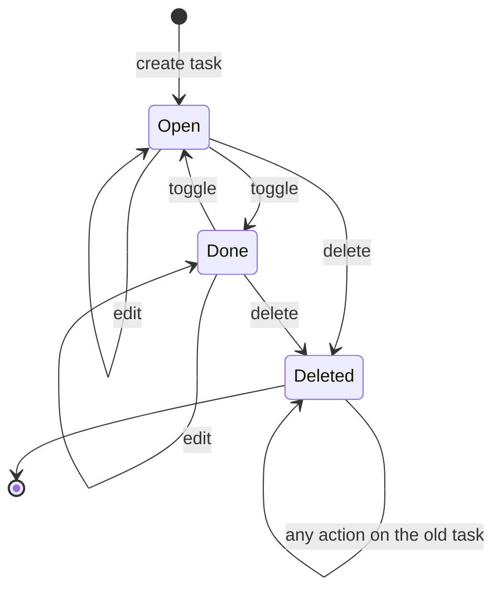

# PyTodo Pro: State Transition Test Design (Week 1)

Owner: QA/Test Lead
Technique: State Transition testing
Features: F-05 Logout (login session) and F-12 Mark done / reopen (task state)

## Introduction

State transition testing looks at the states a thing can be in, and what events move it from one state to another. It also checks events that should not be allowed in a state. It fits these features because the login session and a task both have clear states (logged in or out, open or done), and the same action can have different results depending on the current state.

Urgency labels (F-14) also look like states, but they are worked out from the due date on every page load and are not stored. That feature belongs to the BVA and Decision Table owners, so we only check the "Done" badge here.

## Test data and set up

- Two accounts for all cases: `qa_user1` and `qa_user2`, both with password `testpass123`.
- `qa_user1` needs a few tasks. Each case says which ones.
- Valid? column: Y means the event is allowed in that state. N means the app should refuse it or do nothing.

---

## 1. F-05 Logout (login session)

Implemented in `app.py::login_page`, `register_page`, `logout` and `login_required_web`.

### 1.1 States

| State | Description |
|---|---|
| Anonymous | No `user_id` in the session. Only register and login pages should be usable. |
| Logged In | Session has `user_id`. Task list, dashboard and task forms are usable. |

### 1.2 State diagram

### 1.3 State transition table

| # | Current State | Event/Input | Next State | Valid? (Y/N) |
|---|---|---|---|---|
| S1 | Anonymous | Submit correct username and password | Logged In | Y |
| S2 | Anonymous | Submit a valid new username and password on register | Logged In | Y |
| S3 | Anonymous | Submit wrong password | Anonymous (error message) | N |
| S4 | Anonymous | Open `/`, `/dashboard` or `/tasks/new` directly | Anonymous (redirect to login) | N |
| S5 | Anonymous | Open `/logout` | Anonymous (redirect to login) | N |
| S6 | Logged In | Click Log out | Anonymous | Y |
| S7 | Logged In | Submit login form as a different user | Logged In (as the other user) | Y |
| S8 | Anonymous (after logout) | Press browser Back, then use the old page | Anonymous (redirect to login) | N |
| S9 | Anonymous (after logout in another tab) | Click an action on an old page in the first tab | Anonymous (redirect to login) | N |

### 1.4 Coverage

- All valid transitions (S1, S2, S6, S7) are covered once.
- The invalid ones we think matter most (S3, S4, S5, S8, S9) are also covered.
- We do not test every protected URL for S4. We use three (`/`, `/dashboard`, `/tasks/new`).

### 1.5 Test scenarios

Scenario A: getting into and out of a session. Covers S1, S2, S6, S7.

| TC ID | Title | Preconditions | Steps | Expected Result | Actual Result | Status | Evidence | Defect ID |
|---|---|---|---|---|---|---|---|---|
| TC-BB-060 | Valid login reaches Logged In (S1) | `qa_user1` exists. Logged out. | 1. Open `/login`. 2. Enter `qa_user1` and `testpass123`. 3. Click Log in. | We land on the task list `/`. The top bar shows Tasks, Dashboard, `qa_user1` and Log out. | | | | |
| TC-BB-061 | Register goes straight to Logged In (S2) | Logged out. `qa_user3` does not exist. | 1. Open `/register`. 2. Enter `qa_user3` and `testpass123`. 3. Click Register. | We land on the task list `/` already logged in. The top bar shows `qa_user3`. | | | | |
| TC-BB-062 | Logout returns to Anonymous (S6) | Logged in as `qa_user1`. | 1. Click Log out in the top bar. 2. Look at the page and the top bar. | We land on the login page. The top bar no longer shows Tasks, Dashboard or the username. | | | | |
| TC-BB-063 | Logging in as another user while logged in (S7) | Logged in as `qa_user1`. `qa_user2` exists and has different tasks. | 1. Open `/login` in the same tab. 2. Enter `qa_user2` and `testpass123`. 3. Click Log in. 4. Look at the top bar and the task list. | The top bar shows `qa_user2`. The list only shows `qa_user2` tasks, none from `qa_user1`. We are not sure if the app should block opening `/login` while logged in, we will check in the UI. | | | | |

Scenario B: things that should not work. Covers S3, S4, S5, S8, S9.

| TC ID | Title | Preconditions | Steps | Expected Result | Actual Result | Status | Evidence | Defect ID |
|---|---|---|---|---|---|---|---|---|
| TC-BB-064 | Wrong password keeps us Anonymous (S3) | Logged out. | 1. Open `/login`. 2. Enter `qa_user1` and `wrongpass999`. 3. Click Log in. 4. Open `/` directly. | Step 3 shows "Invalid username or password." and stays on the login form. Step 4 redirects back to the login page. | | | | |
| TC-BB-065 | Protected pages are blocked after logout (S4) | Logged in as `qa_user1`, then logged out. | 1. Type `/dashboard` in the address bar and press Enter. 2. Type `/tasks/new` and press Enter. 3. Type `/` and press Enter. | Each page redirects to the login page. No task data is shown. | | | | |
| TC-BB-066 | Logout page while already logged out (S5) | Logged out. | 1. Type `/logout` in the address bar and press Enter. | We land on the login page. No error page appears. | | | | |
| TC-BB-067 | Back button after logout (S8) | Logged in as `qa_user1` on the task list. | 1. Click Log out. 2. Press the browser Back button. 3. Look at the page. 4. Click Dashboard in the top bar, or press F5. | After step 4 we end up on the login page and cannot use the account. Step 3 may still show the old task list from the browser cache. If it does, that is a possible defect, check in UI. | | | | |
| TC-BB-068 | Stale tab action after logout (S9) | Logged in as `qa_user1` with at least one open task. Task list open in Tab A. | 1. Open the app in Tab B (same browser) and click Log out. 2. Go back to Tab A (still shows the task list). 3. Click the circle button on a task to mark it done. 4. Log in again as `qa_user1` and check that task. | Step 3 redirects to the login page. In step 4 the task is still open. | | | | |

---

## 2. F-12 Mark done / reopen (task state)

Implemented in `app.py::new_task`, `edit_task`, `toggle_task`, `delete_task_web` and `row_to_task`.

### 2.1 States

| State | Description |
|---|---|
| Open | Task exists with `done = 0`. Shows a circle and its urgency badge (or "No due date"). |
| Done | Task exists with `done = 1`. Shows a tick and the "Done" badge. Completion time is saved. |
| Deleted | Task row is gone. It cannot be reached again from the UI. |

### 2.2 State diagram

### 2.3 State transition table

| # | Current State | Event/Input | Next State | Valid? (Y/N) |
|---|---|---|---|---|
| T1 | (no task) | Create task with a title | Open | Y |
| T2 | Open | Click the circle (toggle) | Done | Y |
| T3 | Done | Click the tick (toggle) | Open | Y |
| T4 | Open | Edit title, category or due date and save | Open | Y |
| T5 | Done | Edit title, category or due date and save | Done | Y |
| T6 | Open | Delete and confirm | Deleted | Y |
| T7 | Done | Delete and confirm | Deleted | Y |
| T8 | Open | Delete, then Cancel on the popup | Open | N |
| T9 | Deleted | Toggle from an old page | Deleted | N |
| T10 | Deleted | Open the edit page URL | Deleted | N |
| T11 | Owned by another user | Open the edit page URL | Unchanged | N |

### 2.4 Coverage

- All valid transitions (T1 to T7) are covered once.
- Invalid ones covered: T8, T9, T10, T11.
- Not covered: deleting a task twice (needs the delete form from an old page, nearly the same as T9), and toggling a task that belongs to another user (it is a POST, so we cannot do it by hand in the browser).

### 2.5 Test scenarios

For the dashboard checks, write down the Dashboard numbers before each case (Total, Open, Overdue, Due Soon, Completed) so we can compare.

Scenario C: normal task life cycle. Covers T1 to T7.

| TC ID | Title | Preconditions | Steps | Expected Result | Actual Result | Status | Evidence | Defect ID |
|---|---|---|---|---|---|---|---|---|
| TC-BB-069 | Create task starts as Open (T1) | Logged in as `qa_user1`. Note the Dashboard numbers. | 1. Click + New Task. 2. Enter title `ST open task`, category Study, due date 5 days from today. 3. Click Create Task. 4. Look at the list. 5. Open the Dashboard. | The task is at the top of the list with a circle and the badge "Upcoming". Dashboard Total and Open are each 1 higher. Completed is unchanged. | | | | |
| TC-BB-070 | Open to Done (T2) | Task `ST open task` exists and is open. Note the Dashboard numbers. | 1. On the task list, click the circle next to `ST open task`. 2. Look at the row. 3. Set the Status filter to Done and click Filter. 4. Open the Dashboard. | The row shows a tick and the badge "Done". It appears under the Done filter. Dashboard Open is 1 lower and Completed (last 7 days) is 1 higher. Total is unchanged. | | | | |
| TC-BB-071 | Done back to Open (T3) | Task `ST open task` is Done (after TC-BB-070). Note the Dashboard numbers. | 1. Clear the filters. 2. Click the tick next to `ST open task`. 3. Look at the row. 4. Open the Dashboard. | The row shows a circle and the badge "Upcoming" again. Dashboard Open is 1 higher and Completed is 1 lower. | | | | |
| TC-BB-072 | Edit keeps an Open task Open (T4) | `ST open task` is Open. | 1. Click Edit on `ST open task`. 2. Change the title to `ST open task edited` and category to Work. 3. Click Save Changes. | The task is still open (circle). New title and category show in the list. Dashboard Open and Completed are unchanged. | | | | |
| TC-BB-073 | Edit keeps a Done task Done (T5) | Create `ST done task` and mark it done. Note the Dashboard numbers. | 1. Click Edit on `ST done task`. 2. Change the title to `ST done task edited`. 3. Click Save Changes. 4. Open the Dashboard. | The task is still done (tick, "Done" badge). The new title shows. Dashboard Completed is unchanged. | | | | |
| TC-BB-074 | Delete an Open task (T6) | Create `ST delete open` (open). Note the Dashboard numbers. | 1. Click Delete on `ST delete open`. 2. Click OK on the popup. 3. Look at the list. 4. Open the Dashboard. | The task is gone from the list. Dashboard Total and Open are each 1 lower. | | | | |
| TC-BB-075 | Delete a Done task (T7) | Create `ST delete done` and mark it done. Note the Dashboard numbers. | 1. Click Delete on `ST delete done`. 2. Click OK on the popup. 3. Look at the list. 4. Open the Dashboard. | The task is gone from the list. Dashboard Total and Completed are each 1 lower. Open is unchanged. | | | | |

Scenario D: things that should not change a task. Covers T8 to T11.

| TC ID | Title | Preconditions | Steps | Expected Result | Actual Result | Status | Evidence | Defect ID |
|---|---|---|---|---|---|---|---|---|
| TC-BB-076 | Cancel on the delete popup (T8) | `ST open task edited` exists. | 1. Click Delete on the task. 2. Click Cancel on the popup. 3. Look at the list. | The task is still in the list and still open. | | | | |
| TC-BB-077 | Toggle on a task that was already deleted (T9) | `qa_user1` has task `ST stale` (open). Task list open in Tab A. | 1. In Tab B, open the task list and delete `ST stale`. 2. In Tab A (old page, still shows the task), click the circle next to `ST stale`. 3. Look at the page and the list. | We end up on the task list with no error page. `ST stale` is not in the list, and no new task appears. | | | | |
| TC-BB-078 | Edit page of a deleted task (T10) | Task `ST gone` was created, its edit page URL noted (`/tasks/<id>/edit`), then the task deleted. | 1. Type the noted edit URL in the address bar and press Enter. 2. Look at the page. | The app does not crash. We end up on the task list and no edit form appears. The code does this silently with no message. Possible defect, check in UI, because a "task not found" message would be clearer. | | | | |
| TC-BB-079 | Edit page of another user's task (T11) | `qa_user1` has a task. Its edit URL is noted. Now logged in as `qa_user2`. | 1. Type `qa_user1`'s edit URL in the address bar and press Enter. 2. Look at the page. 3. Log in as `qa_user1` and check that task. | Step 2 does not show the edit form or any of `qa_user1`'s task data. The task is unchanged in step 3. | | | | |

---

## 3. Things we could not work out from the code

- Back button after logout (TC-BB-067). The code sets no cache headers, so the browser may show the old page. We have to check this in each browser we use.
- Opening `/login` or `/register` while logged in (TC-BB-063). The code does not block it and registering replaces the session. We are not sure if that is intended.
- Completion time is not shown anywhere in the task list. We can only see it indirectly through the Completed (last 7 days) number on the Dashboard.
- Edit or toggle on a deleted or foreign task redirects to the list with no message (TC-BB-077 to TC-BB-079). We need to see how that looks in the UI.
- Whether the delete popup behaves the same in every browser (TC-BB-076).
- We have not looked at toggling a task through the API (`PUT` with `done`). That is Week 4.
