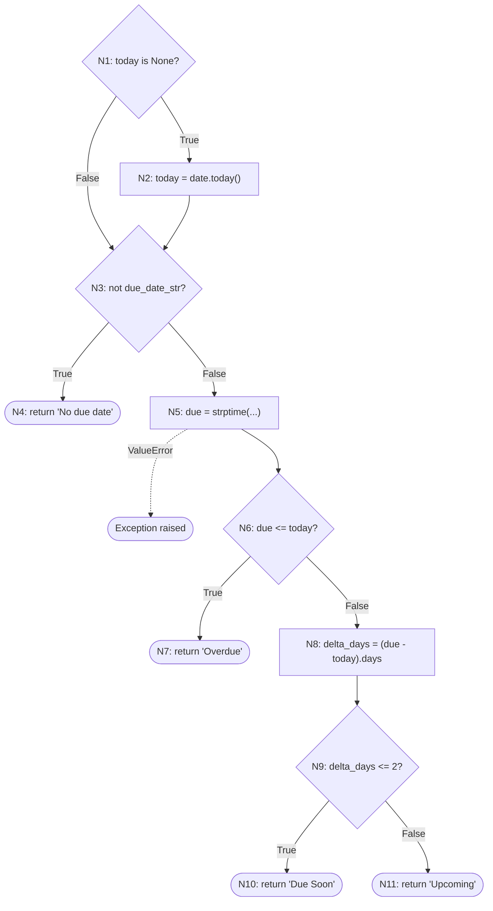

# White-Box Testing: `compute_urgency`

Owner: Defect & Metrics Coordinator
Unit: `compute_urgency(due_date_str, today=None)` in `helpers.py`, lines 12-39
Feature: F-14 Task urgency
Test file: `02_White_Box_Coverage/compute_urgency/tests/test_compute_urgency.py`


---

## 1. Control-flow analysis

### Nodes

| Node | Line(s) | Code |
|---|---|---|
| N1 | 26 | `if today is None:` (decision B1) |
| N2 | 27 | `today = date.today()` |
| N3 | 28 | `if not due_date_str:` (decision B2) |
| N4 | 29 | `return "No due date"` |
| N5 | 31 | `due = datetime.strptime(...)` (can raise `ValueError`) |
| N6 | 33 | `if due <= today:` (decision B3) |
| N7 | 34 | `return "Overdue"` |
| N8 | 36 | `delta_days = (due - today).days` |
| N9 | 37 | `if delta_days <= 2:` (decision B4) |
| N10 | 38 | `return "Due Soon"` |
| N11 | 39 | `return "Upcoming"` |

### Control-flow graph



### Cyclomatic complexity

V(G) = number of decisions + 1 = 4 + 1 = **5**

This matches the radon result: `compute_urgency - A (5)`. So at least 5 test cases are needed to cover the independent paths.

### Independent paths

| Path | Route | Covered by |
|---|---|---|
| P1 | N1(F) → N3(T) → N4 | TC-WB-F14-01, 02 |
| P2 | N1(F) → N3(F) → N5 → N6(T) → N7 | TC-WB-F14-03, 04 |
| P3 | N1(F) → N3(F) → N5 → N6(F) → N8 → N9(T) → N10 | TC-WB-F14-05, 06 |
| P4 | N1(F) → N3(F) → N5 → N6(F) → N8 → N9(F) → N11 | TC-WB-F14-07 |
| P5 | N1(T) → N2 → N3(F) → ... → N11 | TC-WB-F14-08 |
| Exception | N5 raises `ValueError` | TC-WB-F14-09, 10 |

### Data-flow notes

- `today` is defined as a parameter or at line 27. It is used at lines 33 and 36. If a caller passes nothing, the result depends on the system clock. This is why the tests pass a fixed date (10 Nov 2026).
- `due` is defined at line 31 and used at lines 33 and 36. There is no check between the input and its first use, so a bad string fails at the definition itself.
- `delta_days` is defined at line 36 and used only at line 37.
- In the app, `row_to_task` (app.py line 94) calls `compute_urgency(row["due_date"])` without `today`. So every real call uses `date.today()`.

---

## 2. White-box test cases

Common preconditions: Windows 11, Python 3.14.3 (project venv), pytest 9.2.0, pytest-cov 7.1.0, Flask 3.0.3. `helpers.py` can be imported. Fixed `today` = 2026-11-10 unless stated.

Common steps: (1) Call `compute_urgency` with the test data. (2) Compare the return value with the expected result.

| Test Case ID | Technique / Coverage target | Objective | Test Data | Expected Result | Actual Result | Status | Evidence | Defect ID |
|---|---|---|---|---|---|---|---|---|
| TC-WB-F14-01 | Branch B2 True | No due date (None) is labelled correctly | `due_date_str=None` | "No due date" | "No due date" | Pass | pytest log | - |
| TC-WB-F14-02 | Branch B2 True | Empty string counts as no due date | `due_date_str=""` | "No due date" | "No due date" | Pass | pytest log | - |
| TC-WB-F14-03 | Branch B3 True (due < today) | A past date is Overdue | `"2026-11-09"` | "Overdue" | "Overdue" | Pass | pytest log | - |
| TC-WB-F14-04 | Branch B3 True (due = today), boundary | A task due today shows "Due Today" (docstring, README) | `"2026-11-10"` | "Due Today" | "Overdue" | **Fail** | pytest log: `assert 'Overdue' == 'Due Today'` | D-001 |
| TC-WB-F14-05 | Branch B3 False, B4 True | 1 day away is Due Soon | `"2026-11-11"` | "Due Soon" | "Due Soon" | Pass | pytest log | - |
| TC-WB-F14-06 | Branch B4 True, upper boundary | 2 days away is still Due Soon | `"2026-11-12"` | "Due Soon" | "Due Soon" | Pass | pytest log | - |
| TC-WB-F14-07 | Branch B4 False, boundary + 1 | 3 days away is Upcoming | `"2026-11-13"` | "Upcoming" | "Upcoming" | Pass | pytest log | - |
| TC-WB-F14-08 | Branch B1 True | The default `today` is used when none is passed | `date.today() + 30 days`, no `today` | "Upcoming" | "Upcoming" | Pass | pytest log | - |
| TC-WB-F14-09 | Statement N5, exception path | Record what happens with bad input (spec gives no rule) | `"04-11-2026"`, `"abc"`, `"2026-02-30"`, `" "` | `ValueError` raised | `ValueError` raised (4 of 4) | Pass | pytest log | - |
| TC-WB-F14-10 | Exception path, impact check (Flask test client) | A bad due date sent through the API does not break the app | Register user, `POST /api/tasks` with `due_date="04-11-2026"`, then `GET /api/tasks` | Create returns 400, or the list still returns 200 | Create returns 500, list returns 500 | **Fail** | pytest log + traceback (helpers.py line 31) | D-006 |

Note: TC-WB-F14-09 passes because it records the current behaviour. The problem it shows only becomes visible in TC-WB-F14-10.

---

## 3. Execution results

Run by double-clicking `02_White_Box_Coverage/compute_urgency/run_compute_urgency_tests.bat`. It runs this command from the project root and saves the full log to `pytest_output_compute_urgency.txt`:

```
pytest 02_White_Box_Coverage/compute_urgency/tests/test_compute_urgency.py --cov=helpers --cov-branch --cov-report=term-missing --cov-report=html
```

| Metric | Value |
|---|---|
| Test cases planned | 10 |
| Test cases executed | 10 (13 pytest runs, because TC-WB-F14-09 has 4 data values) |
| Passed | 8 |
| Failed | 2 (TC-WB-F14-04, TC-WB-F14-10) |
| Blocked / Not run | 0 |
| Execution rate | 10 / 10 = 100% |
| Pass rate | 8 / 10 = 80% |
| Defects linked | 1 existing (D-001), 1 new (D-006) |

---

## 4. Coverage

| Unit | V(G) | Statements | Statement % | Branches | Branch % | Uncovered lines |
|---|---|---|---|---|---|---|
| `compute_urgency` | 5 | 11 / 11 | 100% | 8 / 8 | 100% | None |

The terminal report shows `helpers.py` at 65% overall. That figure is for the whole file. The missing lines (48, 55, 57, 69-75) belong to other functions. `completed_in_last_n_days` (lines 61-75) is tested by the Automation/Tool Coordinator, so it should not be counted against this unit. The function-level figures above come from the coverage JSON report.

### Interpretation

`compute_urgency` reached 100% statement and branch coverage, yet two tests failed. This shows that full coverage does not mean the code is correct.

The "Due Today" defect (D-001) cannot be found by coverage at all. The spec has five outcomes, but the code has only four return statements. There is no "Due Today" branch to miss. Line 33 uses `due <= today`, so "today" falls into the Overdue branch. Coverage tools only measure code that exists. They cannot report missing logic. This defect was found only because the expected result came from the specification, not from the code.

The second failure (TC-WB-F14-10) is on a line that is fully covered. Line 31 runs in every dated test. The issue is the kind of input, not a missed line. `strptime` has no `try/except`, and the API does not check `due_date` before saving it. So one bad date breaks every later request that lists or counts that user's tasks.

The fixed `today` value was important. Without it, the boundary tests (04, 06, 07) would give different results on different days. TC-WB-F14-08 is the only test that uses the real clock, and it picks a date 30 days away so the result stays stable.

---

## 5. New defect report (draft)

This defect is logged as D-006 in `01_Black_Box/defect_log.md`.

| Field | Detail |
|---|---|
| Defect ID | D-006 |
| Title | Invalid `due_date` accepted by `POST /api/tasks` causes HTTP 500 on all later task list requests |
| Affected Feature | F-19 API create task, F-14 Task urgency, F-18 API task list |
| Environment | Windows 11, Python 3.14.3, Flask 3.0.3, PyTest Flask test client, temporary SQLite database |
| Preconditions | A registered and logged-in user |
| Steps to Reproduce | 1. `POST /api/register` with a valid username and password. 2. `GET /api/tasks` and confirm HTTP 200. 3. `POST /api/tasks` with `{"title": "Bad date task", "due_date": "04-11-2026"}`. 4. `GET /api/tasks` again. |
| Expected Result | Step 3 returns HTTP 400 with a validation error, and nothing is saved. Step 4 returns HTTP 200. |
| Actual Result | Step 3 returns HTTP 500, but the task is still saved. Step 4 returns HTTP 500. Traceback ends in `helpers.py` line 31: `ValueError: time data '04-11-2026' does not match format '%Y-%m-%d'`. |
| Severity | Major (one bad record makes the task list fail for that user until it is removed from the database) |
| Priority | High |
| Evidence | TC-WB-F14-10 pytest output and traceback |
| Status | Open |

The dashboard routes and `GET /api/tasks/<id>` also call `compute_urgency` for open tasks, so they are likely affected too. They were not run in this test.

---

## 6. Evidence files

All in `02_White_Box_Coverage/compute_urgency/evidence/`:

| File | Shows |
|---|---|
| `cu_terminal_results.jpg` | Terminal output: 11 passed, 2 failed, coverage table |
| `cu_function_coverage.png` | Function-level coverage: `compute_urgency` 100% statements, 100% branches |
| `cu_html_lines_12_39.png` | HTML report for lines 12-39, every executable line covered (green bar) |

The full log is `02_White_Box_Coverage/compute_urgency/pytest_output_compute_urgency.txt`. The HTML report folder is not pushed to GitHub (coverage.py adds its own `.gitignore`), so run the `.bat` file to regenerate it.

---

## 7. RTM rows to add

| Requirement/Feature | Test Scenario | Test Case ID(s) | Test Type/Technique | Result | Defect ID |
|---|---|---|---|---|---|
| F-14 Task urgency | Each urgency branch and its boundaries | TC-WB-F14-01 to 08 | White-box / Statement + Branch | 7 Pass, 1 Fail | D-001 |
| F-14 Task urgency | Badly formatted due date | TC-WB-F14-09 | White-box / Exception path | Pass | - |
| F-14, F-19 | Bad due date through API | TC-WB-F14-10 | White-box / Integration impact | Fail | D-006 |
