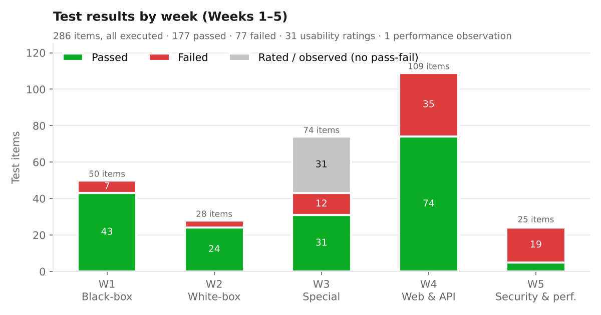
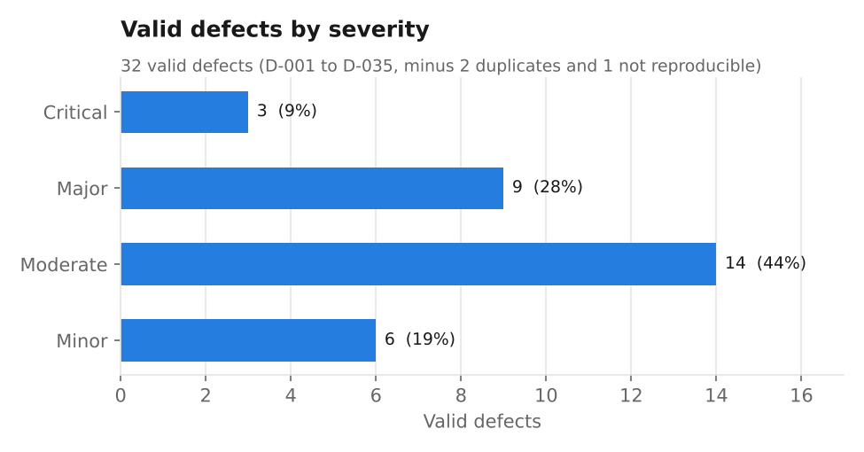
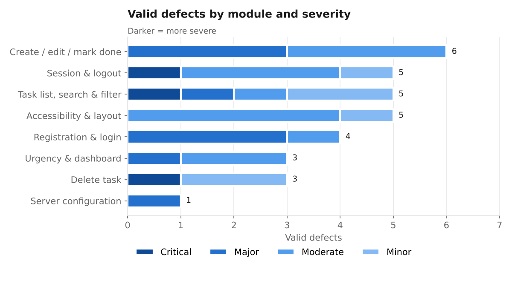
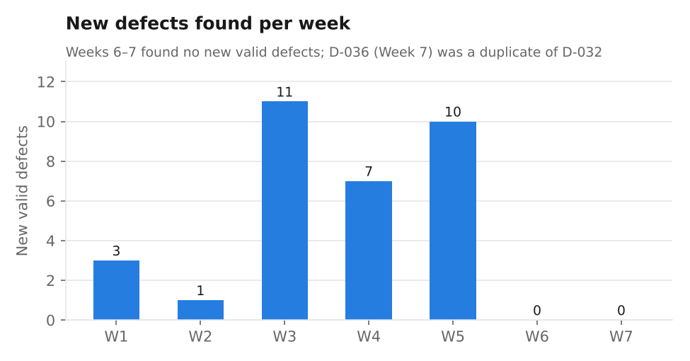
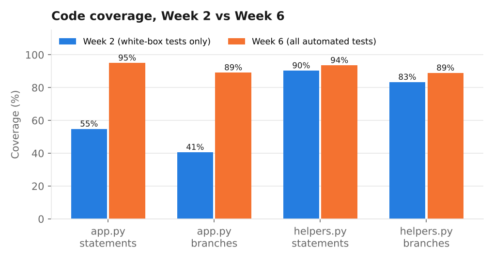

# PyTodo Pro: Final QA Report

**Prepared by:** QA/Test Lead, with sections from Aida (Test Design), Nafiesa (Defect and Metrics) and Nisrina (Automation and Tools)
**Date:** 27 Nov 2026

This report puts our four people's work in one place. It summarises and links. It does not repeat the weekly files. Every number comes from one of our own files. Where two files disagree, we did not choose. We list each conflict in section 14 and say which source we used in the text.

Sources used most: `07_Test_Management/execution_status.md`, `07_Test_Management/defect_log.md`, `07_Test_Management/test_plan.md`, `08_Final_QA_Report/metrics.md`, and the section files in this folder (`lead_sections.md`, `report_sections.md`, `test_design_sections.md`, `section_3_5_automation_performance.md`).

---

## 1. Executive summary

We tested PyTodo Pro, a small Flask 3.0.3 task manager with SQLite, web pages and a JSON API. We tested the local copy only. We used black-box and white-box techniques, GUI, usability, accessibility and compatibility checks, web and API tests, a STRIDE security review, a Locust load test, and an automated regression suite.

Key numbers (`execution_status.md`, `defect_log.md`):
- 286 unique tests, checks and evaluations in Weeks 1 to 5. Of the 254 that give pass or fail, 177 passed and 77 failed. The 31 usability observations were rated 6 Good, 21 Minor issue and 4 Major issue.
- 36 defect IDs, 32 valid. By severity: 3 Critical, 9 Major, 14 Moderate, 6 Minor. 31 are Confirmed, 1 is Open (D-018), and none is fixed.
- 103 automated tests: 69 pass, 34 fail. The regression suite has 51 tests: 22 pass, 29 fail. Every failure is a known defect.
- Load test: 3,416 requests, 0 failed. P95 was 520 ms at 100 users, against our 500 ms target.

Top defects:
- D-025 (Critical): any logged-in user can delete another user's task through `DELETE /api/tasks/<id>`.
- D-020 (Critical): SQL injection in `GET /api/tasks?q=`.
- D-027 (Critical): the secret key is in the source code, so a login cookie can be forged.
- D-010 (Major): stored XSS in task titles.
- D-001 and D-004: a task due today shows as Overdue, and a valid 8-character password is refused.

Verdict: PyTodo Pro is not ready for real users. The normal paths work. The app fails on input checks, ownership checks and server settings. We would not release it until the three Critical defects are fixed. We met 5 of our 11 exit criteria. Testing shows that defects are present. It does not show that nothing else is wrong.

---

## 2. Introduction

PyTodo Pro lets a user register, log in, and manage tasks with a title, a due date and a category. It has a dashboard with counts and an urgency badge on each task. The same features are offered through web pages and through a JSON API under `/api`. There are 22 features (F-01 to F-22) and 3 non-functional requirements (NFR-01 to NFR-03). The list is in `01_Black_Box/feature_inventory.md`.

We act as an independent QA team. We did not write the app, and we did not change it. Our job was to find defects, rate them, report them with evidence, and suggest fixes. The developers would decide and fix. Because of this, we have not retested anything.

Scope (from `test_plan.md`, section 3):
- In scope: web and API authentication, task management, dashboard, the task API, layout, browsers, server settings and load.
- Out of scope: fixing the app, real phones and tablets, Safari, more than 100 users, real users, a real screen reader, and any external scanner or attack tool. All tests ran on our own machines at `127.0.0.1`.

Week 1 only covered the web features. The API, security and performance came later.

---

## 3. Approach

The full plan is in [07_Test_Management/test_plan.md](../07_Test_Management/test_plan.md). In short:
- We picked techniques from the Week 1 risk list: equivalence partitioning, boundary value analysis, decision tables, state transition, white-box statement and branch coverage, GUI and accessibility checks, API tests, STRIDE, and Locust.
- We chose what to automate by a score out of 12 (repetition, stability, criticality, regression value). A score of 9 or more went into the regression suite.
- Tests for known defects assert the correct behaviour. They stay red until the defect is fixed.
- Defects use one central log with severity, priority and a status lifecycle (Open, Confirmed, Retest, Closed). One root cause is one defect.
- Traceability is in [rtm.md](../07_Test_Management/rtm.md) and [master_test_repository.md](../07_Test_Management/master_test_repository.md).

The plan was written in Week 7, after testing. It records what we did. It is not the plan we started with.

---

## 4. Results by area

Counts here come from `execution_status.md` unless we say otherwise.

### 4.1 Black-box (Week 1)

| Technique | Cases | Passed | Failed |
|---|---|---|---|
| Equivalence partitioning (TC-BB-001 to 010) | 10 | 8 | 2 |
| Boundary value analysis | 8 | 5 | 3 |
| Decision table | 12 | 11 | 1 |
| State transition (TC-BB-060 to 079) | 20 | 19 | 1 |

- Defects from Week 1: D-001, D-004 and D-005. D-001 (due today shows Overdue) was found again in Weeks 2, 4 and 6. D-004 (8-character password rejected) and D-005 (7-day counter) came from BVA.
- BVA was our best technique for off-by-one errors. The decision table found nothing new.
- TC-BB-002 was first recorded as Pass. It was wrong, because duplicate usernames are accepted (D-013).
- State transition: the one failure is TC-BB-067 (Back button after logout shows a cached page). It was first logged as D-036 and closed as a duplicate of D-032. Some of these cases ran with the Flask test client. TC-BB-067 and TC-BB-076 were run by hand in a browser.

Files: [01_Black_Box/](../01_Black_Box/).

### 4.2 White-box and coverage (Week 2)

- We wrote 28 white-box tests for four units: `compute_urgency`, `completed_in_last_n_days`, the `index` route, and `toggle_task`.
- Three units reached 100% statement and branch coverage. `toggle_task` is at 0% because we never wrote its tests. Its behaviour is covered by state transition cases (TC-BB-070, 071 and 077), but not its code branches.
- Result: 24 passed and 4 failed (`execution_status.md`). `Week2_Metrics.md` says 26 and 2. See C-04.
- `compute_urgency` had 100% branch coverage and still had D-001. The missing "Due Today" case has no branch for a tool to show. White-box testing did find D-006 (a bad due date breaks the list) and the exact line behind D-005.
- Later, all automated tests together reached 94.8% of statements and 89.0% of branches (`metrics.md`, run of 25 Nov). Running a line is not the same as checking it. Every line of the delete API ran in the passing test API-TSK-DEL-01, and only a test with a second user found D-025.

Files: [02_White_Box_Coverage/](../02_White_Box_Coverage/).

### 4.3 GUI, usability and accessibility (Week 3)

| Check | Items | Result |
|---|---|---|
| GUI checklist (GUI-01 to 18) | 18 | 14 passed, 4 failed |
| Compatibility (COMP-01 to 09) | 9 | 9 passed (45 of 45 results on 5 configurations) |
| Accessibility (ACC-01 to 16) | 16 | 8 passed, 8 failed |
| Usability (US-01 to 31) | 31 | 6 Good, 21 Minor issue, 4 Major issue |

- Week 3 found 11 defects (D-008 to D-018). Accessibility was our weakest area: missing labels (D-009), no accessible name on the done button (D-016), low contrast (D-015), no reflow at 320 px (D-017) and small click targets (D-018).
- The four Major usability issues link to D-013, D-004, D-011 with D-012, and D-001. A form hint says "Minimum 8 characters" and then rejects 8 characters. A task due today shows a red Overdue badge.
- The app gives no success message after create, delete or logout, and Edit and Delete look the same.
- We tested Chrome 157, Edge 157 and Firefox 127 on Windows, plus a simulated phone and tablet. Usability was judged by one person who already knew the app.
- Usability ratings are not defect severities, and they are not in the pass rates. Aida's full summary is in [test_design_sections.md](test_design_sections.md), part B.

Files: [03_Special_Testing/](../03_Special_Testing/).

### 4.4 Web and API (Week 4)

| Suite | Items | Passed | Failed |
|---|---|---|---|
| Core REST API (API-*) | 55 | 43 | 12 |
| Delete and dashboard API (API-DD-01 to 10) | 10 | 6 | 4 |
| UI vs API comparison (TC-API-UI-01 to 30) | 30 | 16 | 14 |
| Web workflows (WTS-01 to 08) | 8 | 8 | 0 |
| Client-server validation (WTS-VAL-01 to 06) | 6 | 1 | 5 |

- Week 4 found 7 defects (D-019 to D-025). Two are Critical and exist only in the API: D-020 and D-025.
- The web pages and the API follow different rules for the same feature. The web delete checks the owner and the web search is safe. The API versions of both are not. Title rules also differ (D-011 against D-022).
- The API returns 500 for wrong data types (D-019) and accepts a bad due date, which then breaks the list and dashboard (D-006).
- D-001, D-004, D-005 and D-013 fail the same way in the web and in the API, because they sit in shared code or in the database.
- We did not test two users at the same time, large lists, or bad `Content-Type` headers.

Files: [04_Web_API/](../04_Web_API/). Aida's summary: [test_design_sections.md](test_design_sections.md), part A.

### 4.5 Security (Week 5)

- We wrote 22 STRIDE threats (TH-01 to TH-22) and one test for each (TC-SEC-01 to 22). All 22 were tested. 19 failed (the threat is real) and 3 passed.
- The 19 failures point to 17 defects: 10 new (D-026 to D-035) and 7 found earlier (D-006, D-010, D-011, D-013, D-014, D-020, D-025).
- Controls that worked: passwords are stored as salted hashes (TC-SEC-13), `GET /api/categories` shows only category names (TC-SEC-16), and the web edit, toggle and delete routes check the owner (TC-SEC-22).
- 10 of the 22 tests prove only part of the threat. For example, the CSRF test looks for a token but does not use a cross-site page.
- We used no external scanners, no password cracking and no flooding.

Details: [lead_sections.md](lead_sections.md) (section 1) and [report_sections.md](report_sections.md) (section A). Files: [05_Security_Performance/](../05_Security_Performance/).

### 4.6 Performance (Week 5)

We ran Locust against 7 API endpoints on the Flask dev server, 30 seconds per stage.

| Stage | Users | Requests | Errors | Average | P95 | Throughput |
|---|---|---|---|---|---|---|
| PERF-01 | 10 | 221 | 0.00% | 24 ms | 140 ms | 7.55 req/s |
| PERF-02 | 50 | 1,073 | 0.00% | 47 ms | 310 ms | 36.92 req/s |
| PERF-03 | 100 | 2,122 | 0.00% | 95 ms | 520 ms | 72.19 req/s |

- 3,416 requests, 0 failed. Throughput grew with the users.
- At 100 users the overall P95 was 520 ms, 20 ms over our 500 ms target. We recorded this as an observation (PERF-OBS-01 and PERF-OBS-02), not a defect.
- Login and register are the slowest, because of password hashing on a single-threaded dev server. A re-run on a 2-core Linux machine had a login average of 1,521 ms, so results depend on the machine.
- Only the API was tested, with small data.

Details: [section_3_5_automation_performance.md](section_3_5_automation_performance.md). Files: [05_Security_Performance/performance_results.md](../05_Security_Performance/performance_results.md).

### 4.7 Automation and regression (Week 6)

| Layer | Tests | Passed | Failed |
|---|---|---|---|
| Unit | 14 | 6 | 8 |
| API and route | 77 | 61 | 16 |
| Browser UI | 12 | 2 | 10 |
| Full suite | 103 | 69 | 34 |
| Regression (`-m regression`) | 51 | 22 | 29 |

- 10 test files. 0 collection or setup errors. All 34 failures map to known defects, so none is a script problem.
- The 29 failing regression tests cover 16 defect IDs. We assert the correct behaviour and do not use `xfail`, so each defect stays visible until it is fixed.
- Both Selenium end-to-end scripts pass. They need Chrome, so they are not in the regression suite.
- Week 6 found no new defects. This is expected for a regression run.
- `requirements.txt` lists only Flask. It does not list pytest, pytest-cov, Selenium or Locust.

Details: [section_3_5_automation_performance.md](section_3_5_automation_performance.md). Files: [06_Automation_Regression/](../06_Automation_Regression/).

---

## 5. Metrics and charts

This section follows [metrics.md](metrics.md) (Nafiesa). `metrics.md` is older than `execution_status.md`, so some totals differ. See C-01 to C-03 in section 14. We show its numbers as they are.

`metrics.md` counts 238 planned and 218 executed tests in Weeks 1 to 5, with 149 passed, 69 failed and 20 not run. The pass rate was 68.3%.

| Week | Activity | Planned | Executed | Passed | Failed | Pass rate |
|---|---|---|---|---|---|---|
| 1 | Black-box | 50 | 30 | 25 | 5 | 83.3% |
| 2 | White-box | 28 | 28 | 26 | 2 | 92.9% |
| 3 | GUI, compatibility, accessibility | 43 | 43 | 30 | 13 | 69.8% |
| 4 | Web and API | 95 | 95 | 65 | 30 | 68.4% |
| 5 | Security | 22 | 22 | 3 | 19 | 13.6% |

The pass rate falls from 92.9% in Week 2 to 13.6% in Week 5. This does not mean the app got worse. In Weeks 1 and 2 we tested normal paths. In Weeks 4 and 5 we aimed at invalid input, other users' data and attacks, which the app does not check.

Notes:
- Defects found per executed test: Security 0.45, GUI and accessibility 0.26, black-box 0.10, web and API 0.07, white-box 0.04 (`metrics.md`, section 3.4).
- Coverage after Week 6: `app.py` 95.0% statements and 89.1% branches, `helpers.py` 93.5% and 88.9%, total 94.8% and 89.0%.
- Chart 1 and the table above still show the older `metrics.md` totals. We did not redraw the charts.
- The performance table is in section 4.6. `metrics.md` section 5 still says "to be added".

---

## 6. Defect analysis

Source: [07_Test_Management/defect_log.md](../07_Test_Management/defect_log.md). 36 IDs were logged. 3 were closed as duplicates (D-002 and D-003 to D-001, D-036 to D-032) and 1 as not reproducible (D-007). That leaves 32 valid defects. 31 are Confirmed and 1 is Open (D-018). None is fixed. The next free ID is D-037.

### 6.1 By severity

| Severity | Count | % | Defect IDs |
|---|---|---|---|
| Critical | 3 | 9.4% | D-020, D-025, D-027 |
| Major | 9 | 28.1% | D-004, D-006, D-010, D-011, D-013, D-022, D-026, D-029, D-031 |
| Moderate | 14 | 43.8% | D-001, D-005, D-009, D-012, D-015, D-016, D-017, D-019, D-021, D-023, D-028, D-032, D-033, D-034 |
| Minor | 6 | 18.8% | D-008, D-014, D-018, D-024, D-030, D-035 |

12 of 32 (37.5%) are Critical or Major. The severity and priority scales agree. No Critical defect has Medium or Low priority.

### 6.2 By feature or module

| Module | Features | Critical | Major | Moderate | Minor | Total |
|---|---|---|---|---|---|---|
| Create, edit, mark done | F-08, F-10, F-12, F-19, F-21 | 0 | 3 | 3 | 0 | 6 |
| Session and logout | F-05 to F-07 | 1 | 0 | 3 | 1 | 5 |
| Task list, search, filter | F-09, F-11, F-18 | 1 | 1 | 1 | 2 | 5 |
| Accessibility and layout | All pages | 0 | 0 | 4 | 1 | 5 |
| Registration and login | F-01 to F-04 | 0 | 3 | 1 | 0 | 4 |
| Urgency and dashboard | F-14 to F-16 | 0 | 1 | 2 | 0 | 3 |
| Delete task | F-13, F-22 | 1 | 0 | 0 | 2 | 3 |
| Server configuration | Whole app | 0 | 1 | 0 | 0 | 1 |
| Total | | 3 | 9 | 14 | 6 | 32 |

### 6.3 What the defects tell us

- By week found: Week 1 had 3, Week 2 had 1, Week 3 had 11, Week 4 had 7, Week 5 had 10, Weeks 6 and 7 had 0.
- 23 of the 32 defects (72%) are about missing input checks, missing ownership checks or weak session and server settings (`metrics.md`, section 4).
- All 3 Critical defects are security defects in the API or in session handling.
- The same root cause was found again by other techniques. D-001 was found in Weeks 1, 2, 4 and 6. D-004 in Weeks 1, 3, 4 and 6. D-013 in Weeks 3, 4, 5 and 6. This raised our confidence, and it also cost time and produced duplicate IDs.
- Defects with the same cause in the web and the API (D-001, D-004, D-005, D-013) point to shared code. Defects that exist in one place only (D-020, D-025) point to rules written twice.

---

## 7. Residual risks and untested areas

All 32 valid defects are still open, so every one of them is a residual risk. The full table has 20 risks (RR-01 to RR-20) with likelihood, impact, why the risk remains and an action. It is in [lead_sections.md](lead_sections.md), section 2. The highest ones:

| Risk | What | Defects or threats |
|---|---|---|
| RR-01 | Any user can delete another user's task through the API | D-025, TH-21 |
| RR-02 | SQL injection in API search (only partly tested) | D-020, TH-07, TH-14 |
| RR-03 | A forged login cookie from the public secret key | D-027, TH-03 |
| RR-04 | Debug mode and the `/console` page (only partly tested) | D-031, TH-11 |
| RR-05 | Stored XSS in task titles (script never seen running) | D-010, TH-05 |
| RR-10 | One bad due date makes the list and dashboard return 500 | D-006, TH-17 |
| RR-16 | Behaviour on a real server with HTTPS is unknown | TH-11, TH-15 |
| RR-19 | No fix has been retested. 29 of 51 regression tests fail | All open defects |

Areas we did not test, or tested lightly:
- Safari, older browsers, and real phones and tablets.
- A real deployment: HTTPS, a production server, a proxy.
- Large data sets, more than 100 users, runs longer than 30 seconds, and the web pages under load.
- Real users and a real screen reader.
- Real attacks: a real brute force, a cross-site page, a script running in a browser, and reading another user's data with the SQL injection.
- White-box tests for `toggle_task`.
- Fixes. Nothing was retested, because nothing was fixed.
- Threats not in our table: HTTPS, session timeout and password strength (RR-20).

---

## 8. Overall quality assessment

PyTodo Pro is not ready for real users. The details are in [lead_sections.md](lead_sections.md), section 3.

| ISO/IEC 25010 characteristic | Summary |
|---|---|
| Functional suitability | Register, login, create, edit, filter, mark done and delete work on the normal paths. Wrong urgency (D-001), password rule (D-004), 7-day counter (D-005) and duplicate usernames (D-013). |
| Usability | Easy to find things. Compatibility passed 45 of 45 results. No success messages. 8 of 16 accessibility checks failed. |
| Security | Hashed passwords and web owner checks work. 19 of 22 security tests failed. All 3 Critical defects are security defects. |
| Performance efficiency | 0 errors in 3,416 requests. P95 520 ms at 100 users, over the 500 ms target. Small data and a dev server only. |
| Reliability | Held under our load test. A bad due date (D-006), wrong data types in the API (D-019) and debug mode (D-031) cause 500 errors or exposure. |
| Maintainability | Not tested directly. The same rule is written twice in the web and the API, which suggests it is hard to keep consistent. |

Exit criteria (`test_plan.md`, section 9.2): we met 5 of 11 (EX-1, EX-2, EX-5, EX-8, EX-10), mostly met 1 (EX-11), partly met 1 (EX-9), and did not meet 4 (EX-3, EX-4, EX-6, EX-7). EX-6 and EX-7 need the developers to fix the defects.

What we cannot claim: testing shows that defects are present. It does not show that there are none. We found 32 valid defects and there are likely more.

---

## 9. Process improvements

These come from the coordinators' sections. Each idea is tied to defects we found.

| Area | Improvement | Defects it would have prevented or caught earlier | Source |
|---|---|---|---|
| Defects | Every defect gets a failing regression test. We set it to Closed only when that test passes. | Repeated finds of D-001, D-004 and D-013, and the duplicate IDs D-002 and D-003 | `report_sections.md`, B |
| Design and requirements | One acceptance table for web and API, with exact boundaries, types, status codes and ownership checks, mapped to test IDs before coding is done. | D-001, D-004, D-005, D-006, D-011, D-019 to D-022, D-025 | `test_design_sections.md`, section 5 |
| Automation and tools | Pin test tools in a `requirements-dev.txt`, give every suite its own temporary database, and run `pytest -m regression` on every pull request. | Environment drift, shared database state, and boundary and parity regressions (D-001, D-004, D-013, D-022) | `section_3_5_automation_performance.md`, section 5 |
| Code review | A short checklist for each pull request: parameterised SQL, an owner check on every query by id, no secrets in code, no `debug=True`. | D-020, D-025, D-027, D-031 | `report_sections.md`, C |
| Static checks | A security linter and an accessibility check (axe or Lighthouse) on every push. | D-009, D-015, D-016, D-017, D-027, D-031 | `report_sections.md`, C |
| Definition of Done | A story is done only with tests for the normal path, invalid input and another user's data. | D-020, D-022, D-025 | `report_sections.md`, C |
| Shared rules | Validation in one function used by both web and API routes. | D-006, D-011, D-019, D-021, D-022 | `report_sections.md`, C |

---

## 10. Prioritised recommendations and future testing

Fixes, in order:
1. Fix the three Critical defects. D-025: add `AND user_id = ?` to the delete query and return 404 if nothing is deleted. D-020: use a parameterised query. D-027: load the key from an environment variable and replace the old key, because it is already public.
2. Fix D-010 (remove the `safe` filter), D-031 (debug off by default), D-006 (check dates on the server), D-026 (rate limit), D-029 (CSRF tokens), D-013 (UNIQUE username) and D-004 (accept 8 characters).
3. Fix the API input checks (D-019, D-021, D-022, D-023, D-024) and the urgency and counter bugs (D-001, D-005).
4. Fix the Moderate and Minor items, including accessibility (D-009, D-015 to D-018), and then run axe and Lighthouse again.

Testing to do next:
- Retest every defect after a fix and run the full suite after each fix. We have not done this.
- Run the CSRF, XSS and Back button checks in a real browser. Test the SQL injection with two accounts to see if data can be read.
- Test with 3 to 5 new users, and with a real screen reader.
- Test on real devices and Safari, and on a real server with HTTPS.
- Repeat the load test on a second machine, for longer, with web pages included. Agree a final target and decide if PERF-OBS-02 becomes a defect.
- Write the white-box tests for `toggle_task`.
- Add pytest, pytest-cov, Selenium and Locust to a requirements file. The README in `06_Automation_Regression/` is empty.
- Add HTTPS, session timeout and password strength to the threat model.

---

## 11. Limitations

- We found defects but did not retest any fix. We cannot say how the app behaves after a fix.
- Many results are shallow. The CSRF test looks for a token only. The SQL injection test changes the query but does not show data being read. Each load stage ran 30 seconds.
- Week 1 black-box testing covered web features only. The API came later.
- Some Week 1 results were wrong at first (TC-BB-002). Others may still be wrong.
- Some state transition cases ran with the Flask test client, not in a browser.
- Usability was one person who knew the app. Compatibility used device mode for phone and tablet.
- Team members used different machines, Python versions and operating systems.
- Severity, priority, and the STRIDE likelihood and impact ratings are our own judgement. TH-13 was wrong about git and we did not change its ratings.
- The master test repository and RTM still have known mistakes (`cross_check_defects.md`). The weekly files are more reliable.
- Our numbers come from several files that were written at different times. Section 14 lists where they disagree.

---

## 12. How our understanding changed

### 12.1 Risk ratings we changed

| Item | Week 1 rating | Later rating | What happened |
|---|---|---|---|
| Stored XSS in task titles | Critical (feature inventory) | D-010 is Major | The STRIDE table rates TH-05 as M for likelihood, because another site would need to add the task (TH-06). We never saw a script run in a browser. |
| Hard-coded secret key | High | D-027 is Critical | Anyone who reads the code can forge a cookie for any user (TH-03). |
| SQL injection in API search, and cross-user delete | Critical | D-020 and D-025 are Critical | The rating stayed. Both were confirmed in Weeks 4 and 5. |
| Database file in git (TH-13) | Treated as a risk | Not in git | The file is in `.gitignore`. We corrected the table but not the ratings. |

The Week 1 "High" label was a different scale from the later priority, so part of this change comes from the new scale.

### 12.2 Assumptions that testing proved wrong

- TC-BB-002 was recorded as Pass. Later weeks showed duplicate usernames are accepted (D-013).
- We thought 100% branch coverage meant the logic was checked. `compute_urgency` had 100% and still had D-001.
- The web pages and the API do not share rules (D-020, D-025, D-011 and D-022). We had planned to compare them because we expected differences, but not that two Critical defects would sit in the API only.
- Our Week 1 risk list named the three worst problems early. We tested them in Weeks 3 to 5, because they were out of scope for Week 1.
- A low pass rate in Week 5 looked bad. It showed where we aimed.

### 12.3 Techniques that found more or less than expected

| Technique | Result |
|---|---|
| BVA | Best for off-by-one errors: D-004, D-005. |
| EP and decision table | Found little that BVA and white-box did not. Only 3 of 32 defects came from Week 1 black-box tests. |
| White-box | Found D-006 and explained D-005. Could not find D-001. |
| GUI, usability, accessibility | 11 defects. Accessibility had never been checked. |
| API testing | 7 defects, two of them Critical, hidden from the web pages. |
| STRIDE | 10 new defects from 22 tests, the highest rate per test (0.45). Some tests are shallow. |
| Automation | Found 0 new defects. It made 31 of 32 defects easy to recheck. |

### 12.4 What we would do differently

- Test the highest risks first, not in Weeks 3 to 5 (`test_plan.md`).
- Compare the web and the API from Week 1.
- Write a defect-to-test link when the defect is logged (`report_sections.md`, B).
- Keep one results file from the start. Our totals drifted across files (section 14).
- List the test tools in a requirements file (`test_plan.md`, limitations).

---

## 13. Appendix: deliverable folders

| Folder | Contents |
|---|---|
| [01_Black_Box/](../01_Black_Box/) | Feature inventory, scope matrix, EP, BVA, decision table and state transition cases, evidence, Week 1 metrics |
| [02_White_Box_Coverage/](../02_White_Box_Coverage/) | Selected units, white-box tests, coverage evidence, Week 2 metrics |
| [03_Special_Testing/](../03_Special_Testing/) | GUI checklist, compatibility matrix, accessibility findings, usability observations, test conventions, evidence |
| [04_Web_API/](../04_Web_API/) | API endpoints, API and web test cases, UI vs API comparison, tests, Week 4 metrics |
| [05_Security_Performance/](../05_Security_Performance/) | STRIDE table, security tests, findings, Locust file, performance plan, results and interpretation |
| [06_Automation_Regression/](../06_Automation_Regression/) | Automation candidates, 10 test files, regression suite, traceability, logs, execution report |
| [07_Test_Management/](../07_Test_Management/) | Test plan, master test repository, RTM, final defect log, execution status, cross-check |
| [08_Final_QA_Report/](./) | This report, metrics, charts, and the section files |
| [09_Presentation/](../09_Presentation/) | Presentation material |

---

## References

Forsgren, N., Humble, J., & Kim, G. (2018). *Accelerate: The science of lean software and DevOps: Building and scaling high performing technology organizations*. IT Revolution Press.

International Software Testing Qualifications Board. (2023). *Certified Tester Foundation Level syllabus* (Version 4.0). ISTQB.

OWASP Foundation. (2021). *OWASP Top 10:2021*. https://owasp.org/Top10/

World Wide Web Consortium. (2023). *Web Content Accessibility Guidelines (WCAG) 2.2*. W3C. https://www.w3.org/TR/WCAG22/

---

## 14. Conflicts between our source files

We did not choose between these. The column "Used here" says which source the report followed in the text.

| ID | Conflict | Source A | Source B | Used here |
|---|---|---|---|---|
| C-01 | Test totals for Weeks 1 to 5. Week 1 also differs: 30 executed (25 pass, 5 fail, 20 state transition Not Run) against 50 executed (43 pass, 7 fail). | `metrics.md`: 238 planned, 218 executed, 149 passed, 69 failed, 20 not run | `execution_status.md`: 286 items, 177 passed, 77 failed | B in sections 1 and 4. A only in section 5. |
| C-02 | Defect IDs logged and duplicates | `metrics.md`: 35 IDs, duplicates D-002 and D-003 | `defect_log.md`: 36 IDs, duplicates D-002, D-003 and D-036 | B |
| C-03 | Automation numbers. Also run time: about 14 s (A), 26.77 s for the full suite and 14.61 s for regression (B and `logs/full_suite.log`), "a few seconds" (`test_plan.md`). | `metrics.md` and `report_sections.md`: 193 tests (122 pass, 71 fail), 32 regression tests (12 pass, 20 fail). The 63% is 122 of 193, not the regression rate. `test_plan.md` EX-5 also cites 71 failures. | `execution_status.md`: 103 tests (69 pass, 34 fail), 51 regression tests (22 pass, 29 fail) | B in section 4.7. The coverage of 94.8% and 89.0% is from the 25 Nov run of A. We did not run it again. |
| C-04 | White-box result | `Week2_Metrics.md` and `metrics.md`: 26 pass, 2 fail | `execution_status.md` and `section_3_5_automation_performance.md`: 24 pass, 4 fail (TC-WB-F11-11 and TC-WB-F15-03 count as Fail against the specification) | B |
| C-05 | GUI result, and D-007 | `Week3_Metrics.md`: GUI 13 pass, 5 fail, D-007 open. `metrics.md` Week 3: 30 pass, 13 fail | `execution_status.md`: GUI 14 pass, 4 fail. `defect_log.md`: D-007 Closed (Not reproducible). | B |
| C-06 | Were the Week 1 state transition cases run? | `metrics.md` section 6 and `test_design_sections.md`: no recorded results, Not Run | `tc_state_transition.md` and `execution_status.md`: 19 pass, 1 fail | B |
| C-07 | Week 4 count and web scenarios | `metrics.md`: 95 items, without the 8 web workflow scenarios | `execution_status.md` and `test_design_sections.md`: 109 items with the 8 web scenarios and 6 validation checks | B in section 4.4. The 95 is also shown. |
| C-08 | Next defect ID for PERF-OBS-02 | `performance_interpretation.md`: log as D-036 | `defect_log.md`: D-036 is taken. The next free ID is D-037. | B |
| C-09 | How usability is counted, and which defects it links to | `Week3_Metrics.md`: "25 issues" in a Failed column. `test_design_sections.md` total line: 7 defects (D-001, D-004, D-011, D-012, D-013, D-014, D-032), but its table also names D-016 and D-018 | `metrics.md` and `execution_status.md`: ratings only, not in pass rates. `usability_observations.md` now also links D-008 and D-016. | Ratings only, as in B |
| C-10 | Old gaps in `metrics.md` that are now closed or changed: performance "to be added", 20 state transition cases not run, chart 1 shows the old totals | `metrics.md` | `execution_status.md`, `performance_results.md` | B. We did not redraw the charts. |
| C-11 | CI section | `report_sections.md` says the Automation/Tool Coordinator describes a GitHub Actions pipeline | `section_3_5_automation_performance.md` has no pipeline description. It only recommends running `pytest -m regression` on each pull request. | We describe no pipeline, because none is in the files. |

Not conflicts, but still open: the master test repository is cut off and has wrong descriptions (`cross_check_defects.md`), and the RTM has corrections pending. We did not edit those files.
