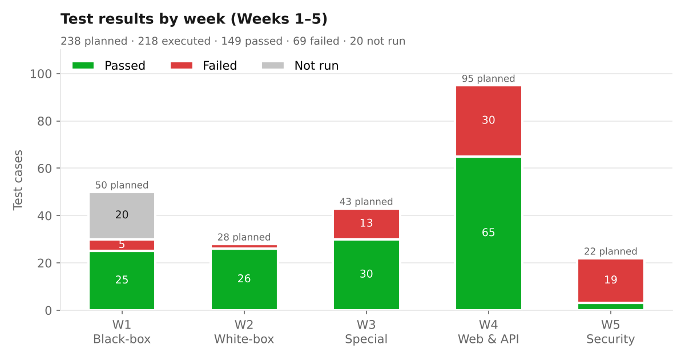

# Week 8 Metrics - PyTodo Pro

**Prepared by:** Nafiesa (Defect & Metrics Coordinator)
**Date:** 25 Nov 2026
**Week 8 tasks:** 1 (planned / executed / passed / failed / blocked counts and rates) and 2 (defects by severity and by feature/module)
**Sources:** weekly metrics files (Weeks 1–4), `05_Security_Performance/security_test_cases.md`, the automated run on 25 Nov 2026 (`06_Automation_Regression/week6_defect_check.md`) and the final defect log (`07_Test_Management/defect_log.md`)

> **Still to add:** Week 5 performance results. Nisrina's performance files are not in the repo yet. They are measured in response time, not pass/fail, so they will be added as their own table in section 5 and will not change the counts below.

---

## 1. Test execution metrics

### 1.1 By week (unique test cases, Weeks 1–5)

Each test case is counted once, in the week it was designed. Re-runs in later weeks are counted separately in section 2, so nothing is counted twice.

| Week | Activity | Planned | Executed | Passed | Failed | Blocked | Not Run | Execution rate | Pass rate |
| :--- | :--- | :---: | :---: | :---: | :---: | :---: | :---: | :---: | :---: |
| 1 | Black-box (EP 10, BVA 8, decision table 12, state transition 20) | 50 | 30 | 25 | 5 | 0 | 20 | 60.0% | 83.3% |
| 2 | White-box (`index`, `completed_in_last_n_days`, `compute_urgency`) | 28 | 28 | 26 | 2 | 0 | 0 | 100.0% | 92.9% |
| 3 | GUI, compatibility, accessibility checks | 43 | 43 | 30 | 13 | 0 | 0 | 100.0% | 69.8% |
| 4 | Web and API (automated) | 95 | 95 | 65 | 30 | 0 | 0 | 100.0% | 68.4% |
| 5 | Security (automated) | 22 | 22 | 3 | 19 | 0 | 0 | 100.0% | 13.6% |
| **Total** | | **238** | **218** | **149** | **69** | **0** | **20** | **91.6%** | **68.3%** |

**Formulas:** Execution rate = Executed ÷ Planned. Pass rate = Passed ÷ Executed. Failure rate = Failed ÷ Executed = **31.7%**.

**Notes on the counts**
- **Week 1** now includes Aida's EP cases (10) and the state transition design (20). `Week1_Metrics.md` counted only the decision table and BVA cases (20). The 20 state transition cases have no Actual Result or Status, so they are **Not Run**, which lowers the Week 1 execution rate to 60%.
- **Week 1, TC-BB-002** is still recorded as Pass, but later weeks show duplicate usernames are accepted (D-013). If its owner changes it to Fail, the totals become 148 passed and 70 failed (pass rate 67.9%).
- **Week 2:** the fourth unit, `toggle_task`, has no test cases, so it adds nothing to Planned. It is listed as an untested area in section 6.
- **Week 3:** the 31 usability observations use ratings, not Pass/Fail, so they are not counted here: 6 Good, 21 Minor issue, 4 Major issue. Compatibility counts as 9 checks (45 results on 5 configurations).
- **Week 3, GUI-01** failed because of D-007, which is now `Closed (Not reproducible)`. If a re-run passes, Week 3 becomes 31 passed and 12 failed.
- **Week 4** excludes `test_api_smoke.py` (2 setup checks) and the 8 web workflow scenarios, which have no Pass/Fail column.
- **Blocked = 0** in every week. No test was stopped by a broken environment or a missing feature.

### 1.2 Why the pass rate falls week by week

The pass rate drops from 92.9% (Week 2) to 13.6% (Week 5). This does **not** mean the app got worse. It shows where we aimed our tests:
- Weeks 1–2 tested the normal paths of core features, which mostly work.
- Weeks 4–5 aimed at invalid input, other users' data and attacks. These are the places the app does not check, so most of those tests fail.

A low pass rate in Week 5 means the security tests found real gaps. It does not mean they were badly designed.

---

## 2. Automation and regression metrics (Week 6)

| Metric | Value |
| :--- | :---: |
| Automated tests in the repo | 193 (150 from Weeks 2, 4, 5 + 43 new in Week 6) |
| Passed / Failed / Errors | 122 / 71 / 0 |
| Failures caused by real product defects | 71 of 71 (100%) |
| Failures caused by broken scripts | 0 |
| New defects found by the regression run | 0 |
| Regression-marked tests (Nafiesa's scripts) | 32 (12 pass, 20 fail) |
| Valid defects caught by at least one automated test | **31 of 32 (96.9%)**, up from 26 of 32 (81.3%) before Week 6 |
| Defect not automated | D-018 (needs a real browser to measure target size) |
| Full suite run time | about 14 seconds |

The 71 failures are expected. Each one is a test that guards an open defect. When the developers fix a defect, its tests should turn green. That is how we will know the fix worked, and that nothing else broke.

### 2.1 Code coverage (all automated tests together)

| File | Statements | Statement % | Branches | Branch % | Week 2 statement % | Week 2 branch % |
| :--- | :---: | :---: | :---: | :---: | :---: | :---: |
| `app.py` | 284 / 299 | **95.0%** | 57 / 64 | **89.1%** | 54.8% | 40.6% |
| `helpers.py` | 29 / 31 | **93.5%** | 16 / 18 | **88.9%** | 90.3% | 83.3% |
| **Total** | 313 / 330 | **94.8%** | 73 / 82 | **89.0%** | | |

Command: `pytest 02_White_Box_Coverage 04_Web_API 05_Security_Performance 06_Automation_Regression --cov=app --cov=helpers --cov-branch` (25 Nov 2026).

High coverage means most lines **ran** during a test. It does not mean they were **checked** properly. For example, every line of the delete API already ran in the normal delete test `API-TSK-DEL-01`, which passes. The missing owner check (D-025) was only found when another test used a second user.

**Uncovered lines worth noting:** no automated test saves a task through the **web edit form** (`app.py` lines 256–265) or marks a task done through the **web toggle** (lines 277–280). These two web features have only been tested by hand. The other uncovered lines are the `__main__` start-up block (481–482) and two small branches. The Automation/Tool Coordinator interprets these in her report section.

---

## 3. Defect metrics

### 3.1 Summary

| Item | Count |
| :--- | :---: |
| Defect IDs logged | 35 |
| Duplicates closed (D-002, D-003) | 2 |
| Not reproducible, closed (D-007) | 1 |
| **Valid unique defects** | **32** |
| Confirmed / Open / Retest / Closed-fixed | 31 / 1 / 0 / 0 |

### 3.2 By severity

| Severity | Count | % of valid |
| :--- | :---: | :---: |
| Critical | 3 | 9.4% |
| Major | 9 | 28.1% |
| Moderate | 14 | 43.8% |
| Minor | 6 | 18.8% |
| **Total** | **32** | **100%** |

**37.5%** of valid defects (12 of 32) are Critical or Major. All 3 Critical defects are security defects in the JSON API or session handling: D-020 (SQL injection), D-025 (deleting another user's task) and D-027 (hard-coded secret key).

### 3.3 By feature / module

| Module | Features | Critical | Major | Moderate | Minor | Total | % |
| :--- | :--- | :---: | :---: | :---: | :---: | :---: | :---: |
| Create / edit / mark done | F-08, F-10, F-12, F-19, F-21 | 0 | 3 | 3 | 0 | 6 | 18.8% |
| Session & logout | F-05 to F-07 | 1 | 0 | 3 | 1 | 5 | 15.6% |
| Task list, search & filter | F-09, F-11, F-18 | 1 | 1 | 1 | 2 | 5 | 15.6% |
| Accessibility & layout | All pages | 0 | 0 | 4 | 1 | 5 | 15.6% |
| Registration & login | F-01 to F-04 | 0 | 3 | 1 | 0 | 4 | 12.5% |
| Urgency & dashboard | F-14 to F-16 | 0 | 1 | 2 | 0 | 3 | 9.4% |
| Delete task | F-13, F-22 | 1 | 0 | 0 | 2 | 3 | 9.4% |
| Server configuration | Whole app | 0 | 1 | 0 | 0 | 1 | 3.1% |
| **Total** | | **3** | **9** | **14** | **6** | **32** | **100%** |

### 3.4 By week found and by technique

| Week | Technique | New valid defects | Defects per executed test |
| :--- | :--- | :---: | :---: |
| 1 | Black-box (EP, BVA, decision table) | 3 | 3 / 30 = 0.10 |
| 2 | White-box | 1 | 1 / 28 = 0.04 |
| 3 | GUI, usability, accessibility | 11 | 11 / 43 = 0.26 (plus usability observations) |
| 4 | Web and API | 7 | 7 / 95 = 0.07 |
| 5 | Security (STRIDE) | 10 | 10 / 22 = 0.45 |
| 6 | Automation and regression | 0 | 0 / 193 = 0 |
| **Total** | | **32** | **32 / 218 = 0.15** |

### 3.5 Defects found again in later weeks

| Defect | First found | Found again in |
| :--- | :--- | :--- |
| D-001 Due today shown as Overdue | Week 1 (black-box) | Week 2 (white-box), Week 4 (API, dashboard), Week 6 (regression) |
| D-004 8-character password rejected | Week 1 (BVA) | Week 3 (usability), Week 4 (API), Week 6 (helper, web and API) |
| D-006 Bad due date breaks pages | Week 2 (white-box) | Week 4 (API, dashboard), Week 5 (web route), Week 6 |
| D-013 Duplicate usernames | Week 3 (usability) | Week 4 (API), Week 5 (security), Week 6 |
| D-020 SQL injection | Week 4 (API) | Week 5 (security), Week 6 |
| D-025 Cross-user delete | Week 4 (API) | Week 5 (security), Week 6 |

The same root cause showed up through different techniques. This raised our confidence in each defect, and in most cases showed that it affects more than one layer (web and API).

---

## 4. Interpretation

1. **The core flows mostly work.** Normal register (with 9+ characters), login, create, filter and complete tasks pass in Weeks 1, 2 and 6.
2. **Validation and security are the weakest areas.** 23 of the 32 valid defects (72%) involve missing input checks, missing ownership checks or weak session and server settings (D-006, D-010 to D-014, D-019 to D-035).
3. **The JSON API is less safe than the web pages.** The web delete checks the owner and the web search uses a safe query, but the API does neither (D-020, D-025). The same feature was built twice with different rules.
4. **Security testing found the most defects per test** (0.45 per test). Week 3 special testing was next (0.26), because accessibility had never been checked.
5. **Week 6 found no new defects, and this is expected.** Regression tests re-check known behaviour. Their value is that 31 of 32 defects are now checked automatically, in about 14 seconds.
6. **Testing has not shown that the app is defect-free.** It shows that 32 defects exist, mostly in validation and security, and that the normal paths we tested work. The areas in section 6 were not tested, or were tested only lightly.

## 5. Performance (to be added)

| Endpoint / page | Users | Avg response (ms) | 95th percentile (ms) | Throughput (req/s) | Error rate |
| :--- | :---: | :---: | :---: | :---: | :---: |
| *Waiting for `performance_results.md`* | | | | | |

## 6. Gaps that affect these metrics

| Gap | Effect on the metrics |
| :--- | :--- |
| 20 state transition cases not executed (F-05 Logout, F-12 Mark done) | Week 1 execution rate is 60%; session state changes were tested only through security tests |
| `toggle_task` white-box unit not tested | Still uncovered: no automated test marks a task done through the web (lines 277–280). The web edit save (lines 256–265) is also uncovered |
| Performance results not yet in repo | No response-time or load figures in this report yet |
| D-018 target size not automated | 1 defect relies on a manual browser check |
| Usability rated, not Pass/Fail | 31 observations are reported separately, not in pass rates |
