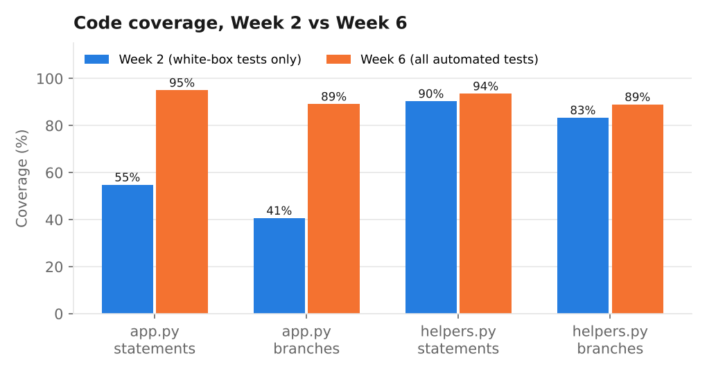
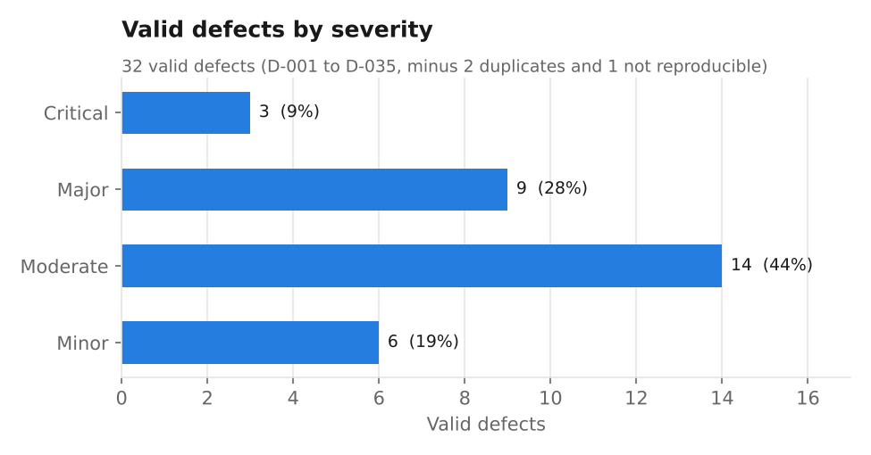
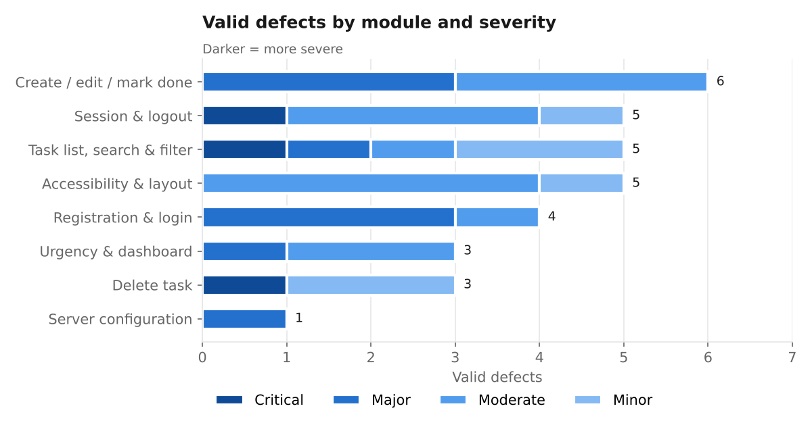
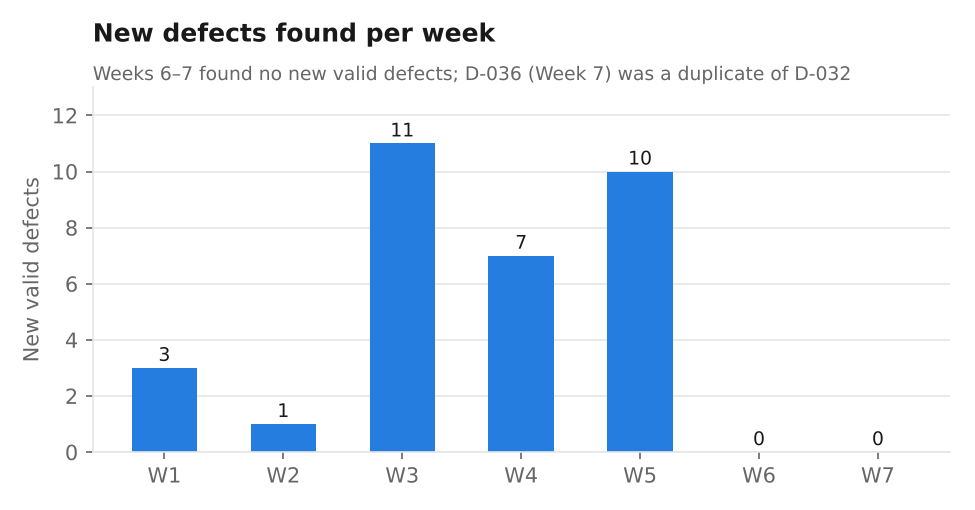

# Week 8 Metrics - PyTodo Pro

**Prepared by:** Nafiesa (Defect & Metrics Coordinator)
**Version:** 2 (final), 27 Nov 2026
**Week 8 tasks:** 1 (planned / executed / passed / failed / blocked counts and rates) and 2 (defects by severity and by feature/module)
**Sources:** `07_Test_Management/master_test_repository.md` and `execution_status.md` (test results), `07_Test_Management/defect_log.md` (defects), `06_Automation_Regression/execution_report.md` (automation), `05_Security_Performance/performance_results.md` (performance)

> **What changed from version 1 (25 Nov):** test counts now follow the reconciled master test repository (Week 7, Order 5). The 20 state transition cases have been run, the 8 web workflow scenarios, 6 validation checks and 3 performance stages are now counted, and 5 results were corrected (`TC-BB-002`, `TC-WB-F11-11`, `TC-WB-F15-03`, `GUI-01`, `GUI-05`). D-036 was added and closed as a duplicate of D-032. Automation now has 103 tests in the Week 6 suite.

---

## 1. Test execution metrics

### 1.1 By week and technique (unique items, Weeks 1–5)

Each item is counted once, in the week it was designed. Week 6 automated re-runs are counted separately in section 2, so nothing is counted twice.

| Week | Technique / test type | Items | Executed | Passed | Failed | Blocked | Rated / observed | Pass rate |
| :---: | :--- | :---: | :---: | :---: | :---: | :---: | :---: | :---: |
| 1 | Equivalence partitioning | 10 | 10 | 8 | 2 | 0 | - | 80.0% |
| 1 | Boundary value analysis | 8 | 8 | 5 | 3 | 0 | - | 62.5% |
| 1 | Decision table | 12 | 12 | 11 | 1 | 0 | - | 91.7% |
| 1 | State transition | 20 | 20 | 19 | 1 | 0 | - | 95.0% |
| 2 | White-box (path and branch) | 28 | 28 | 24 | 4 | 0 | - | 85.7% |
| 3 | GUI checklist | 18 | 18 | 14 | 4 | 0 | - | 77.8% |
| 3 | Compatibility (9 pages x 5 configurations) | 9 | 9 | 9 | 0 | 0 | - | 100.0% |
| 3 | Accessibility (WCAG 2.2) | 16 | 16 | 8 | 8 | 0 | - | 50.0% |
| 3 | Usability evaluation | 31 | 31 | - | - | 0 | 31 ratings | - |
| 4 | Web workflow scenarios | 8 | 8 | 8 | 0 | 0 | - | 100.0% |
| 4 | Client-server validation | 6 | 6 | 1 | 5 | 0 | - | 16.7% |
| 4 | REST API endpoints | 55 | 55 | 43 | 12 | 0 | - | 78.2% |
| 4 | Extra delete and dashboard API | 10 | 10 | 6 | 4 | 0 | - | 60.0% |
| 4 | UI vs API comparison | 30 | 30 | 16 | 14 | 0 | - | 53.3% |
| 5 | STRIDE security tests | 22 | 22 | 3 | 19 | 0 | - | 13.6% |
| 5 | Performance stages (Locust) | 3 | 3 | 2 | 0 | 0 | 1 observation | 100.0% of 2 |
| **Total** | | **286** | **286** | **177** | **77** | **0** | **31 + 1** | **69.7%** |

### 1.2 By week

| Week | Activity | Items | Pass/Fail items | Passed | Failed | Pass rate |
| :---: | :--- | :---: | :---: | :---: | :---: | :---: |
| 1 | Black-box | 50 | 50 | 43 | 7 | 86.0% |
| 2 | White-box | 28 | 28 | 24 | 4 | 85.7% |
| 3 | GUI, compatibility, accessibility, usability | 74 | 43 | 31 | 12 | 72.1% |
| 4 | Web and API | 109 | 109 | 74 | 35 | 67.9% |
| 5 | Security and performance | 25 | 24 | 5 | 19 | 20.8% |
| **Total** | | **286** | **254** | **177** | **77** | **69.7%** |

**Formulas**
- Execution rate = Executed ÷ Planned = 286 ÷ 286 = **100%**. Every designed item was run.
- Pass rate = Passed ÷ Pass/Fail items = 177 ÷ 254 = **69.7%**.
- Failure rate = Failed ÷ Pass/Fail items = 77 ÷ 254 = **30.3%**.
- Blocked = **0**. No test was stopped by a broken environment or a missing feature.

**Notes on the counts**
- **Usability (31)** uses ratings, not Pass/Fail: **6 Good, 21 Minor issue, 4 Major issue**. These items are executed but left out of the pass rate.
- **Performance (3 stages)**: Stages 1 and 2 met every target. Stage 3 met 3 of 4 targets (P95 520 ms against 500 ms), so it is recorded as an **observation**, not a pass or a fail (see section 5).
- **White-box** counts `TC-WB-F11-11` and `TC-WB-F15-03` as **Fail**. Their pytest scripts were written to reproduce defects D-014 and D-005, so the scripts pass while the defects are present. Against the expected behaviour in the specification, both test cases fail.
- **Compatibility** counts each page once. In total, 45 of 45 page-and-configuration results passed.

### 1.3 Why the pass rate falls week by week

The pass rate drops from 86.0% (Week 1) to 20.8% (Week 5). This does **not** mean the app got worse. It shows where we aimed our tests:
- Weeks 1–2 tested the normal paths of core features, which mostly work.
- Weeks 4–5 aimed at invalid input, other users' data and attacks. These are the places the app does not check, so most of those tests fail.

A low pass rate in Week 5 means the security tests found real gaps. It does not mean they were badly designed.

---

## 2. Automation and regression metrics (Week 6)

### 2.1 Week 6 suite (`06_Automation_Regression/tests/`)

| Layer | Files | Tests | Passed | Failed |
| :--- | :--- | :---: | :---: | :---: |
| Unit | `test_bva_unit.py`, `test_ep_urgency_unit.py`, `test_reg_decision_table.py` | 28 | 20 | 8 |
| API / route | `test_api_auth.py`, `test_ep_and_core_api.py`, `test_reg_api_delete_dashboard.py`, `test_state_transition.py` | 59 | 43 | 16 |
| UI | `test_ui_auth.py`, `test_ui_tasks.py` (Selenium), `test_reg_accessibility_markup.py` (HTML/CSS) | 16 | 6 | 10 |
| **Total** | **10 files** | **103** | **69** | **34** |

**Regression subset** (`pytest 06_Automation_Regression/tests -m regression`): **51 tests, 22 passed, 29 failed** (14.61 s, `logs/regression_suite.log`). Full suite: 26.77 s (`logs/full_suite.log`).

### 2.2 All automated tests in the repository

| Metric | Value |
| :--- | :---: |
| Automated tests | **253** (150 from Weeks 2, 4, 5 + 103 in the Week 6 suite) |
| Passed / Failed / Errors | 168 / 85 / 0 |
| Failures caused by real product defects | 85 of 85 (100%) |
| Failures caused by broken scripts | 0 |
| New defects found by automation | 0 |
| Valid defects caught by at least one automated test | **31 of 32 (96.9%)**, up from 26 of 32 (81.3%) before Week 6 |
| Defect not automated | D-018 (needs a real browser to measure target size) |
| Known defects D-004 and D-001 | Both caught, by 4 tests each |

These numbers count **automated runs**, not unique test cases. Most Week 6 tests re-run cases already counted in section 1.

The 85 failures are expected. Each one is a test that guards an open defect. When the developers fix a defect, its tests should turn green. That is how we will know the fix worked, and that nothing else broke.

### 2.1 Code coverage (all automated tests together)

| File | Statements | Statement % | Branches | Branch % | Week 2 statement % | Week 2 branch % |
| :--- | :---: | :---: | :---: | :---: | :---: | :---: |
| `app.py` | 284 / 299 | **95.0%** | 57 / 64 | **89.1%** | 54.8% | 40.6% |
| `helpers.py` | 29 / 31 | **93.5%** | 16 / 18 | **88.9%** | 90.3% | 83.3% |
| **Total** | 313 / 330 | **94.8%** | 73 / 82 | **89.0%** | | |

Command: `pytest 02_White_Box_Coverage 04_Web_API 05_Security_Performance 06_Automation_Regression --cov=app --cov=helpers --cov-branch` (25 Nov 2026, before the 18 state transition tests were added; they test routes that were already covered).

High coverage means most lines **ran** during a test. It does not mean they were **checked** properly. For example, every line of the delete API already ran in the normal delete test `API-TSK-DEL-01`, which passes. The missing owner check (D-025) was only found when another test used a second user.

**Uncovered lines worth noting (25 Nov):** no automated test saved a task through the **web edit form** (`app.py` lines 256–265) or marked a task done through the **web toggle** (lines 277–280). The state transition tests added on 26 Nov (`test_state_transition.py`) now exercise the toggle. The other uncovered lines are the `__main__` start-up block (481–482) and two small branches. The Automation/Tool Coordinator interprets these in her report section.

---

## 3. Defect metrics

### 3.1 Summary

| Item | Count |
| :--- | :---: |
| Defect IDs logged | 36 |
| Duplicates closed (D-002, D-003 → D-001; D-036 → D-032) | 3 |
| Not reproducible, closed (D-007) | 1 |
| **Valid unique defects** | **32** |
| Confirmed / Open / Retest / Closed-fixed | 31 / 1 / 0 / 0 |
| Next free defect ID | D-037 |

### 3.2 By severity

| Severity | Count | % of valid |
| :--- | :---: | :---: |
| Critical | 3 | 9.4% |
| Major | 9 | 28.1% |
| Moderate | 14 | 43.8% |
| Minor | 6 | 18.8% |
| **Total** | **32** | **100%** |

**37.5%** of valid defects (12 of 32) are Critical or Major. All 3 Critical defects are security defects in the JSON API or session handling: D-020 (SQL injection), D-025 (deleting another user's task) and D-027 (hard-coded secret key).

### 3.3 By feature / module

| Module | Features | Critical | Major | Moderate | Minor | Total | % |
| :--- | :--- | :---: | :---: | :---: | :---: | :---: | :---: |
| Create / edit / mark done | F-08, F-10, F-12, F-19, F-21 | 0 | 3 | 3 | 0 | 6 | 18.8% |
| Session & logout | F-05 to F-07 | 1 | 0 | 3 | 1 | 5 | 15.6% |
| Task list, search & filter | F-09, F-11, F-18 | 1 | 1 | 1 | 2 | 5 | 15.6% |
| Accessibility & layout | All pages | 0 | 0 | 4 | 1 | 5 | 15.6% |
| Registration & login | F-01 to F-04 | 0 | 3 | 1 | 0 | 4 | 12.5% |
| Urgency & dashboard | F-14 to F-16 | 0 | 1 | 2 | 0 | 3 | 9.4% |
| Delete task | F-13, F-22 | 1 | 0 | 0 | 2 | 3 | 9.4% |
| Server configuration | Whole app | 0 | 1 | 0 | 0 | 1 | 3.1% |
| **Total** | | **3** | **9** | **14** | **6** | **32** | **100%** |

### 3.4 By week found and by technique

| Week | Technique | New valid defects | Pass/Fail items | Defects per item |
| :---: | :--- | :---: | :---: | :---: |
| 1 | Black-box (EP, BVA, decision table, state transition) | 3 | 50 | 0.06 |
| 2 | White-box | 1 | 28 | 0.04 |
| 3 | GUI, usability, accessibility | 11 | 43 (+31 ratings) | 0.26 |
| 4 | Web and API | 7 | 109 | 0.06 |
| 5 | Security and performance | 10 | 24 | 0.42 |
| 6 | Automation and regression | 0 | (103 re-runs) | 0 |
| 7 | State transition run | 0 (D-036 = duplicate of D-032) | - | 0 |
| **Total** | | **32** | **254** | **0.13** |

### 3.5 Defects found again in later weeks

| Defect | First found | Found again in |
| :--- | :--- | :--- |
| D-001 Due today shown as Overdue | Week 1 (black-box) | Week 2 (white-box), Week 4 (API, dashboard), Week 6 (regression) |
| D-004 8-character password rejected | Week 1 (BVA) | Week 3 (usability), Week 4 (API), Week 6 (helper, web and API) |
| D-006 Bad due date breaks pages | Week 2 (white-box) | Week 4 (API, dashboard), Week 5 (web route), Week 6 |
| D-013 Duplicate usernames | Week 3 (usability) | Week 4 (API), Week 5 (security), Week 6 |
| D-020 SQL injection | Week 4 (API) | Week 5 (security), Week 6 |
| D-025 Cross-user delete | Week 4 (API) | Week 5 (security), Week 6 |

The same root cause showed up through different techniques. This raised our confidence in each defect, and in most cases showed that it affects more than one layer (web and API).

---

## 4. Interpretation

1. **Every designed test was run.** The execution rate is 100% (286 of 286), and nothing was blocked.
2. **The core flows mostly work.** Normal register (with 9+ characters), login, create, filter, complete and logout pass in Weeks 1, 2, 4 and 6, including all 20 state transitions except the Back-button case.
3. **Validation and security are the weakest areas.** 23 of the 32 valid defects (72%) involve missing input checks, missing ownership checks or weak session and server settings (D-006, D-010 to D-014, D-019 to D-035).
4. **The JSON API is less safe than the web pages.** The web delete checks the owner and the web search uses a safe query, but the API does neither (D-020, D-025). The same feature was built twice with different rules.
5. **Security testing found the most defects per test** (0.42 per item). Week 3 special testing was next (0.26), because accessibility had never been checked.
6. **Weeks 6 and 7 found no new valid defects, and this is expected.** Regression tests re-check known behaviour. Their value is that 31 of 32 defects are now checked automatically, in under 30 seconds. The one new ID in Week 7 (D-036) turned out to be a duplicate.
7. **Testing has not shown that the app is defect-free.** It shows that 32 defects exist, mostly in validation and security, and that the normal paths we tested work. The areas in section 6 were not tested, or were tested only lightly.

## 5. Performance (Week 5)

Source: `05_Security_Performance/performance_results.md` (Locust, API only, 30 s per stage). Interpretation: `05_Security_Performance/performance_interpretation.md`.

| Stage | Users | Requests | Errors | Avg (ms) | Median (ms) | P95 (ms) | Max (ms) | Throughput (req/s) | Targets met |
| :--- | :---: | :---: | :---: | :---: | :---: | :---: | :---: | :---: | :---: |
| 1 Baseline | 10 | 221 | 0 (0.00%) | 24 | 10 | 140 | 204 | 7.55 | 4 of 4 |
| 2 Moderate | 50 | 1,073 | 0 (0.00%) | 47 | 13 | 310 | 770 | 36.92 | 4 of 4 |
| 3 High | 100 | 2,122 | 0 (0.00%) | 95 | 19 | 520 | 1,478 | 72.19 | 3 of 4 (P95 above 500 ms) |
| **Total** | | **3,416** | **0** | | | | | | |

Targets: average < 200 ms, P95 < 500 ms, error rate < 1%, throughput grows with users.

**Key points**
- **Stable:** 0 errors in 3,416 requests, up to 100 concurrent users.
- **Scales:** 10 times the users gave 9.6 times the throughput.
- **Bottleneck:** login and register (password hashing). At 100 users, register averaged 662 ms (P95 1,200 ms). All task, dashboard and category endpoints stayed below 500 ms P95 in every stage.
- **No new defect:** the targets were met under normal load (Stages 1 and 2), and the Stage 3 P95 miss comes from deliberate password hashing during a login burst. It is recorded as observations PERF-OBS-01 and PERF-OBS-02 for the risk section. If the team logs PERF-OBS-02 as a defect, it becomes **D-037** (D-036 is now taken).
- **Repeated:** a second run on another machine showed the same pattern (`05_Security_Performance/evidence_performance_rerun.txt`). It was slower on fewer CPU cores, so the absolute numbers depend on the hardware.

## 6. Gaps that affect these metrics

| Gap | Effect on the metrics |
| :--- | :--- |
| Usability rated, not Pass/Fail | 31 observations are reported as ratings and left out of the pass rate |
| `toggle_task` white-box unit not tested in Week 2 | No branch-focused unit test; the toggle is covered by state transition tests instead |
| Performance tested on the API only, 30 s per stage, one run each, load generator on the same machine | Response times describe this setup only; web pages, long runs and the failure point were not tested |
| D-018 target size not automated | 1 defect relies on a manual browser check |
| Coverage measured on 25 Nov | Does not include the 18 state transition tests added on 26 Nov; the real figure can only be the same or higher |
